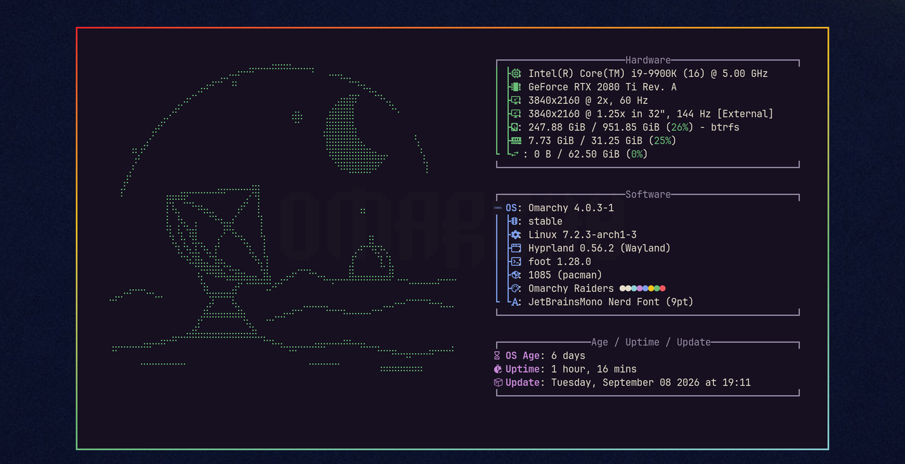
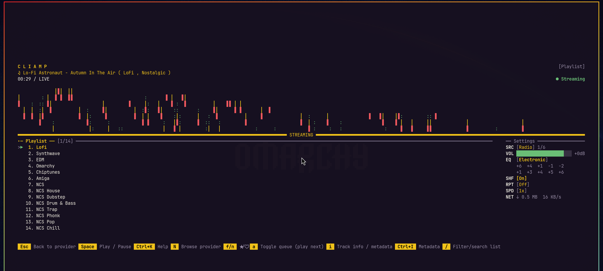

# 🤖 Omarchy Raiders extras

Optional extras for the [Omarchy Raiders](https://github.com/itsMattGuenther/omarchy-omarchy-raiders-theme)
Omarchy theme: an original radio telescope beneath a crescent moon greeting you
in every new terminal, a wider listening-station landscape on the About screen,
and a matching theme for the cliamp music player.

```bash
~/.local/share/omarchy-theme-extras/omarchy-raiders/install.sh              # install or update
~/.local/share/omarchy-theme-extras/omarchy-raiders/install.sh --uninstall  # remove
```

See the [main README](../README.md) for what the installer changes.
Reinstalling while the theme is active refreshes the art without replacing the
backup of your original About logo.

## 🖼️ The art

Rendered terminal greeting (56 columns by 18 rows):


Rendered About layout (64 columns by 24 rows of art). The installed About file
is plain text so Omarchy can measure its width correctly. It inherits
fastfetch's logo color. The greeting uses the full theme palette:



## 🎵 cliamp



A matching theme for the [cliamp](https://github.com/omacom-io/cliamp) music
player. The theme hook switches cliamp to it while Omarchy Raiders is active
and puts your previous cliamp theme back when you switch away.

## 📁 What's here

- `cliamp/omarchy-raiders.toml` — the music player theme.
- `art/greeting-art.ansi` — **Still listening**, a radio telescope and crescent
  printed in the theme palette when a terminal opens.
- `art/greeting-art.txt` — a plain text fallback for the greeting.
- `art/omarchy-raiders-ridge.txt` — **The listening station**, the About drawing.
  The filename stays the same for existing installations.
- `art/*.svg` — original, editable vector sources.
- `art/render.py` — the included SVG-to-Braille converter.
- `greeting.sh` — prints the artwork only in interactive Bash while this
  theme is active. It reads static files and starts no external programs.
- `hooks/omarchy-raiders-theme-set.sh` — switches cliamp and the About logo
  with the theme and restores their previous state when switching away.

## 🔭 The artwork

The greeting is a compact 56-column by 18-row drawing. The About piece is
64 columns by 24 rows, with a distant observatory and layered terrain.
Cream and cyan describe the instrument, muted blue marks the horizon, and
gold lights the feed and a single star. The forms use general astronomy
imagery; no game character, machine, logo, or screenshot is used.

- **Still listening:** a crescent, a broken orbital trace, and a mesh radio
  dish, composed for 56 columns by 18 rows.
- **The listening station:** a wider companion with a distant dome and
  layered terrain, composed for 64 columns by 24 rows.

Both SVGs were drawn directly from geometric primitives for this project.
They are not traced or converted from the theme's wallpapers or another
artist's image. `art/render.py` produces matching plain text and ANSI colour
files. The existing `omarchy-raiders-ridge` basename is retained for
compatibility; the drawing itself is new.

The installer uses the plain About file so Omarchy's `wc -L` width
measurement stays accurate. fastfetch supplies its logo colour. A full-colour
`.ansi` version is also included for standalone viewing or a custom layout.
Each ANSI row resets its colour. Both variants have the same visible cells.

The documentation illustrations are rendered text previews, not desktop
screenshots. The About preview uses fastfetch output.
[The rendered preview](docs/preview-art.png) shows both installed styles.

## 🛠️ Redrawing and previewing

From the root of this repo, with Python 3.11+, librsvg (`rsvg-convert`) and
ImageMagick (`magick`) available:

```bash
python3 omarchy-raiders/art/render.py
cat omarchy-raiders/art/greeting-art.ansi
cat omarchy-raiders/art/omarchy-raiders-ridge.ansi
fastfetch --logo-type file --logo omarchy-raiders/art/omarchy-raiders-ridge.txt
```

The palette comes from the installed theme's `colors.toml`. To render against
a checkout of the theme repo instead, set `THEME_DIR`:

```bash
THEME_DIR=~/src/omarchy-omarchy-raiders-theme python3 omarchy-raiders/art/render.py
```

The converter writes both `.txt` and `.ansi` versions. Its SVG canvas uses
one unit per dot; a Braille cell is 2 by 4 dots. Keep the greeting at 112x72
and the About source at 128x96 to preserve the installed layouts. Leave the
background transparent and use the colours in the theme's `colors.toml`.
These tools are only needed to regenerate art; installation and startup use
the checked-in text files.

## 🙏 Credits

The art is original, prepared for this theme and distributed under this
repository's MIT license. Omarchy Raiders is an unofficial tribute and is not
affiliated with, endorsed by, or associated with Embark Studios or Nexon; ARC
Raiders is their trademark. No artwork from the game is included.
