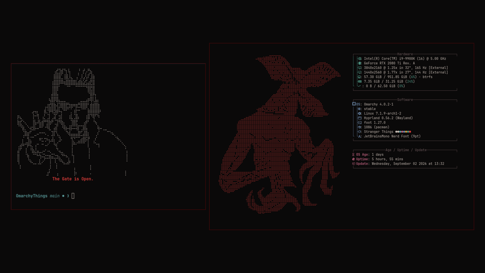
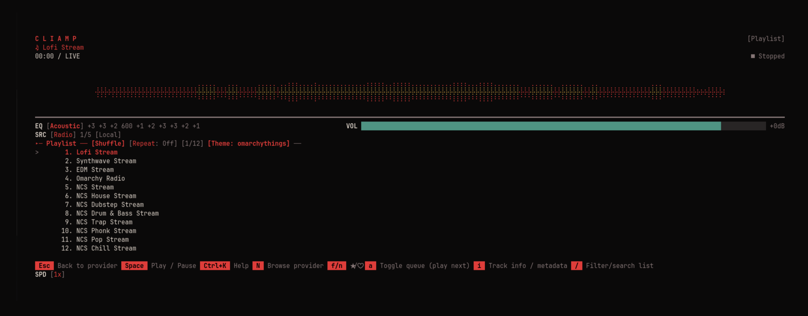

# 🔴 OmarchyThings extras

Optional extras for the [OmarchyThings](https://github.com/itsMattGuenther/omarchy-omarchy-things-theme)
Omarchy theme: a Demogorgon on the About screen, Eleven greeting you in every
new terminal, and a matching theme for the cliamp music player.





```bash
~/.local/share/omarchy-theme-extras/omarchy-things/install.sh              # install or update
~/.local/share/omarchy-theme-extras/omarchy-things/install.sh --uninstall  # remove
```

See the [main README](../README.md) for what the installer changes. The hook
puts the Demogorgon in Omarchy's About logo slot
(`~/.config/omarchy/branding/about.txt`) with the original kept as a backup,
and puts it back when you pick another theme.

## 📁 What's here

- `cliamp/omarchy-things.toml` — music player theme
- `fastfetch/demogorgon.txt` — Demogorgon for the About screen. The installer
  colors it red and the hook drops it into `~/.config/omarchy/branding/about.txt`,
  so Omarchy sizes the About window to fit it.
- `greeting.sh` + `eleven.txt` — Eleven printed when a terminal opens, only
  while the theme is active
- `hooks/omarchy-things-theme-set.sh` — switches cliamp and the About logo with
  the theme

## 🛠️ Tools for working on the theme

These run against a checkout of the theme repo, not this one.

- `tools/contrast.py` checks readability after palette edits:

  ```bash
  python3 omarchy-things/tools/contrast.py ~/src/omarchy-omarchy-things-theme/colors.toml
  ```

- `tools/make-unlock.sh` regenerates `preview-unlock.png`, the tile Omarchy
  shows in its **Style > Unlock** picker. Run it from the theme checkout's root:

  ```bash
  cd ~/src/omarchy-omarchy-things-theme
  ~/.local/share/omarchy-theme-extras/omarchy-things/tools/make-unlock.sh
  ```

## 🙏 Credits

- Demogorgon and Eleven Braille art from
  [emojicombos.com](https://emojicombos.com/stranger-things-ascii-art).
- Fan-made and unofficial. Not affiliated with Netflix or the creators of
  Stranger Things. No official artwork, logos, or fonts are included.
