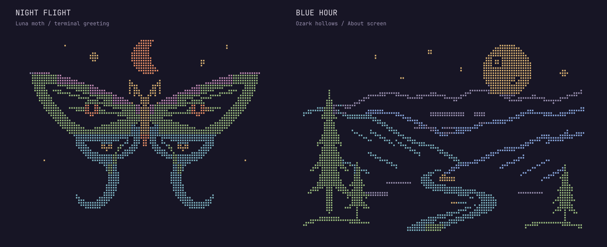
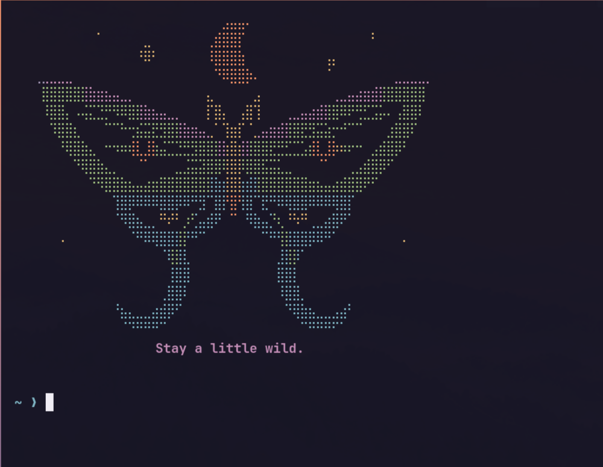
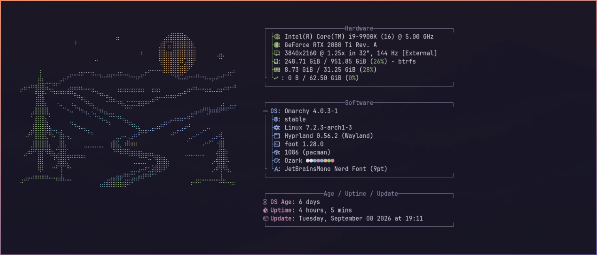
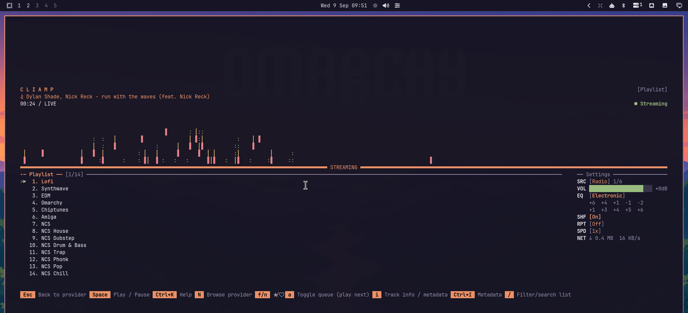

# 🏔️ Ozark extras

Optional extras for the [Ozark](https://github.com/itsMattGuenther/omarchy-ozark-theme)
Omarchy theme: a luna moth greeting you in every new terminal, moonlit Ozark
hollows on the About screen, and a matching theme for the cliamp music player.

```bash
~/.local/share/omarchy-theme-extras/ozark/install.sh              # install or update
~/.local/share/omarchy-theme-extras/ozark/install.sh --uninstall  # remove
```

See the [main README](../README.md) for what the installer changes.

## 🖼️ The art



Two original pieces of colored Braille art, drawn as vectors for the terminal's
small dot grid. Broad silhouettes, open wing veins, and separate colors for the
landscape layers bring the Ozarks into the terminal after dark.

**Night Flight** — a luna moth with sweeping green wings, copper eyespots,
blue ribbon tails, and a crescent overhead — greets you in every new terminal.
Stay a little wild.



**Blue Hour** — a golden moon above receding Ozark ridges, green cedars, and
a bright river curling through the hollow — takes over the About screen:



The greeting is 56 columns by 18 rows; About is 64 columns by 20 rows. About
uses short terminal palette codes to keep Omarchy's window measurement
compact. The artwork preview renders the actual color text files; the
greeting and About images are desktop captures. Set `NO_COLOR=1` for a
monochrome greeting.

## 🎵 cliamp



A matching theme for the [cliamp](https://github.com/omacom-io/cliamp) music
player. The theme hook switches cliamp to it while Ozark is active and puts
your previous cliamp theme back when you switch away.

## 📁 What's here

- `cliamp/ozark.toml` — music player theme
- `art/luna-moth.ansi.txt` — Night Flight, printed when a terminal opens
- `art/ozark-ridge.ansi.txt` — Blue Hour, dropped into Omarchy's About logo slot
  (`~/.config/omarchy/branding/about.txt`) so Omarchy sizes the About window
  to fit it
- `art/luna-moth.txt`, `art/ozark-ridge.txt` — monochrome versions
- `art/*.svg` — the editable vector sources
- `art/render.py` — regenerates plain and ANSI text from the SVG sources
- `art/preview.py` — renders the color text to `docs/preview-art.png`
- `greeting.sh` — prints the moth, only while this theme is active
- `hooks/ozark-theme-set.sh` — switches cliamp and the About logo with the
  theme. Named after the theme on purpose: `omarchy hook install` copies by
  basename, so a hook called `theme-set.sh` would overwrite another theme's.

## 🛠️ Redrawing the art

Both pieces come from the SVGs in `art/`. The drawings use theme colors for
dots and the theme background for open space. To regenerate, with Python 3.11+
and ImageMagick installed:

```bash
python3 ozark/art/render.py
python3 ozark/art/preview.py
```

The palette comes from the installed theme's `colors.toml`. To render against
a checkout of the theme repo instead, set `THEME_DIR`:

```bash
THEME_DIR=~/src/omarchy-ozark-theme python3 ozark/art/render.py
```

Night Flight stays at 56 columns by 18 rows and Blue Hour at 64 columns by 20
rows. Each Braille cell uses the dominant ink among its eight dots. Antialiased
edges retain their ink hue, and blank cells preserve the full canvas width.

The moth uses true color; About uses short ANSI codes that pick up the active
Ozark terminal palette. Omarchy counts the printable parts of these escape
codes when sizing its window, so short codes avoid excessive extra width.
Every color line ends with a reset. The greeting uses the plain text version
when `NO_COLOR` is nonempty. Preview rendering also needs JetBrainsMono Nerd Font.

Run `install.sh` again after editing the art. Updating an active Ozark About
image preserves the original logo backup used when switching away.

## 🙏 Credits

The luna moth and the Ozark hollows are original work for this theme.
